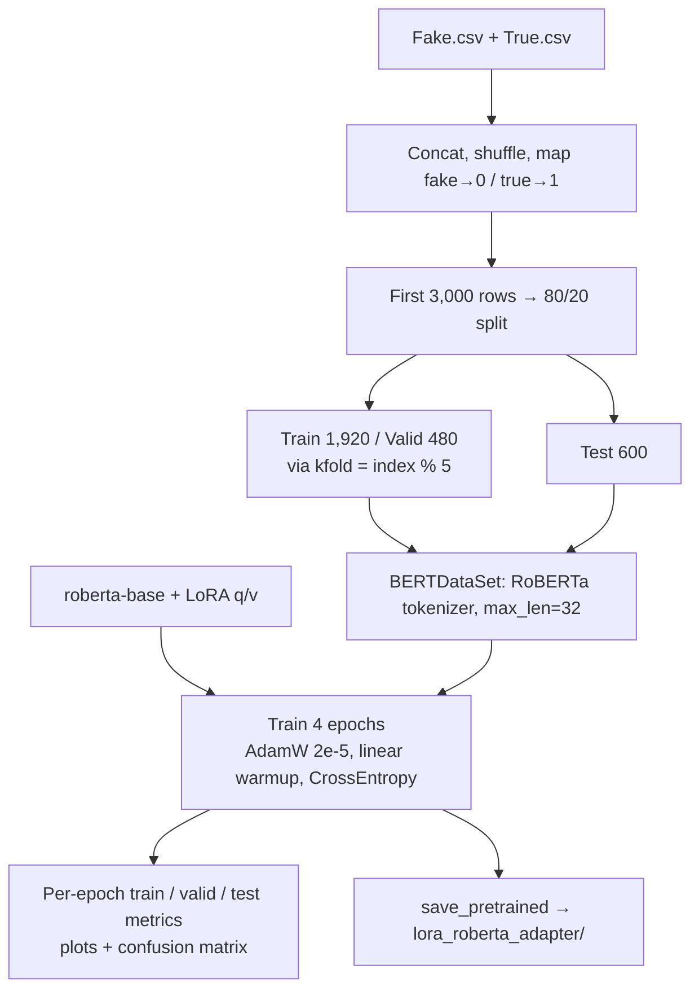

# Fake News Detection Using LLMs

Fake/real news classification with **RoBERTa-base** fine-tuned using **LoRA** (Parameter-Efficient Fine-Tuning via 🤗 PEFT).

> M.Tech research project by **Tushar Raj**, under the supervision of **Prof. Dr. S. Sumitra**.
> Full write-up: [TusharRaj_Project_report_SC24M150.pdf](TusharRaj_Project_report_SC24M150.pdf) · Slides: [project_ppt.pptx](project_ppt.pptx)

## Highlights

| Item | Value |
|---|---|
| Base model | `roberta-base` |
| Fine-tuning | LoRA `r=8`, `alpha=16`, `dropout=0.1` on attention `query`/`value` + trainable classifier head |
| Trainable parameters | ≈ 0.9M of ≈ 125M (≈ 0.7%) |
| Task | Binary classification: `0 = fake`, `1 = true` |
| Max length / epochs | 32 tokens / 4 epochs |
| Test accuracy / F1 | **99.17% / 0.9917** (600 held-out articles) |

## Repository Structure

```
├── Fake_news_detection_using_lora.ipynb   # Full pipeline: data → LoRA training → evaluation
├── lora_roberta_adapter/                  # Saved LoRA adapter (~3.6 MB) + tokenizer
│   └── new/                               # Second saved checkpoint (same config)
├── TusharRaj_Project_report_SC24M150.pdf  # Project report
└── project_ppt.pptx                       # Slides
```

## Setup

Download `Fake.csv` and `True.csv` from the [Kaggle Fake and Real News Dataset](https://www.kaggle.com/datasets/clmentbisaillon/fake-and-real-news-dataset) and place them next to the notebook. The notebook was run on Google Colab (T4 GPU).

```bash
pip install torch transformers peft scikit-learn pandas matplotlib seaborn chardet
```

## LoRA: The Math

Full fine-tuning updates every weight matrix $W_0 \in \mathbb{R}^{d \times k}$ of the pre-trained model. LoRA freezes $W_0$ and learns a **low-rank update** instead:

$$
W = W_0 + \Delta W = W_0 + \frac{\alpha}{r} BA, \qquad B \in \mathbb{R}^{d \times r},\; A \in \mathbb{R}^{r \times k},\; r \ll \min(d, k)
$$

**Forward pass.** For an input $x$, the adapted layer computes

$$
h = W_0 x + \frac{\alpha}{r} B A \,\mathrm{Dropout}(x)
$$

The frozen path $W_0 x$ is unchanged; the LoRA path projects $x$ down to $r$ dimensions with $A$ and back up to $d$ with $B$.

**Initialization.** $A$ is initialized randomly and $B = 0$, so $\Delta W = BA = 0$ at the start. Training therefore begins exactly from the pre-trained model.

**Training.** With cross-entropy loss over the two classes,

$$
\mathcal{L} = -\frac{1}{N} \sum_{i=1}^{N} \log \frac{e^{z_{i, y_i}}}{\sum_{c \in \{0,1\}} e^{z_{i,c}}}
$$

where $z_i$ are the logits for sample $i$. Gradients flow only to $A$, $B$ and the classifier head; $W_0$ stays fixed ($\nabla_{W_0} = 0$).

**Parameter savings.** One attention projection in RoBERTa-base has $d = k = 768$:

| | Formula | Count |
|---|---|---:|
| Full update $\Delta W$ | $d \times k$ | 589,824 |
| LoRA update $BA$ ($r=8$) | $r(d + k)$ | 12,288 (≈ 2.1%) |

Applied to `query` and `value` in all 12 layers, this gives $12 \times 2 \times 12{,}288 = 294{,}912$ LoRA parameters. Together with the ≈ 0.59M classifier head, about 0.9M parameters are trained, which is why the saved adapter is only ~3.6 MB.

**Inference.** Since $BA$ has the same shape as $W_0$, it can be merged into a single matrix $W = W_0 + \frac{\alpha}{r}BA$, so LoRA adds no extra inference latency. In this project $\frac{\alpha}{r} = \frac{16}{8} = 2$.

## Code Flow



1. **Setup (cells 1–5)** – imports, device selection, `random_seed(508)` for reproducibility.
2. **Data (cells 7–9)** – load both CSVs, keep the `text` column, shuffle, encode labels (`fake→0`, `true→1`).
3. **Split (cells 10, 17)** – take the first 3,000 rows, `train_test_split(test_size=0.2)`. The train pool is sorted by label and split by `kfold = index % 5`: fold 0 is validation, folds 1–4 are training.
4. **Dataset (cells 11–20)** – `BERTDataSet` tokenizes each article to 32 tokens and returns `ids`, `mask`, `targets`. DataLoaders use batch 16 (train) and 32 (valid/test).
5. **Model (cells 21–25)** – `RobertaForSequenceClassification(num_labels=2)` wrapped with `LoraConfig(task_type=SEQ_CLS, r=8, lora_alpha=16)`. Base weights stay frozen; only the LoRA matrices and the classifier head train.
6. **Optimization (cells 26–28)** – `AdamW(lr=2e-5, weight_decay=0.01)`, linear schedule with 10% warmup over 480 steps, `CrossEntropyLoss`.
7. **Train loop (cells 29–33)** – `training()`, `validating()` and `testing()` run every epoch and return loss, weighted F1 and accuracy.
8. **Visualization (cells 34–35)** – loss / F1 / accuracy curves and a confusion matrix for the last epoch.
9. **Save and reload (cells 37–39)** – `model.save_pretrained("lora_roberta_adapter")`, then reload with `PeftModel.from_pretrained(base_model, ...)`.

## Results

| Epoch | Train Loss | Valid Loss | Valid Acc | Test Loss | Test Acc |
|:---:|---:|---:|---:|---:|---:|
| 1 | 0.6785 | 0.6424 | 0.9708 | 0.6402 | 0.9733 |
| 2 | 0.4800 | 0.2241 | 0.9938 | 0.2305 | 0.9933 |
| 3 | 0.1212 | 0.0470 | 0.9938 | 0.0535 | 0.9933 |
| 4 | 0.0424 | 0.0352 | 0.9938 | 0.0422 | **0.9917** |

Validation and test accuracy pass 97% after the first epoch and level off at about 99% from epoch 2 onward, while training only ≈ 0.7% of the model's parameters.

## Using the Saved Adapter

```python
import torch
from transformers import RobertaTokenizer, RobertaForSequenceClassification
from peft import PeftModel

# Load the base model and attach the trained LoRA adapter
tokenizer = RobertaTokenizer.from_pretrained("./lora_roberta_adapter")
base = RobertaForSequenceClassification.from_pretrained("roberta-base", num_labels=2)
model = PeftModel.from_pretrained(base, "./lora_roberta_adapter").eval()

text = "WASHINGTON (Reuters) - The U.S. Senate on Tuesday passed a bill ..."
inputs = tokenizer(text, return_tensors="pt", truncation=True, max_length=32)

with torch.no_grad():
    probs = torch.softmax(model(**inputs).logits, dim=-1)[0]

label = ["fake", "true"][probs.argmax().item()]
print(f"Prediction: {label} (confidence {probs.max().item():.4f})")
```

Use `max_length=32` to match how the model was trained.

## Conclusion

LoRA fine-tuning of RoBERTa-base reaches **99.17% test accuracy** on the Fake and Real News dataset while training under 1% of the parameters and storing the result in a ~3.6 MB adapter. This makes the approach cheap to train on a single Colab GPU and easy to share.

Two caveats apply. The model was trained on only 3,000 of the 44,898 articles. And most real articles in `True.csv` begin with a `(Reuters)` dateline, so part of the accuracy may come from recognizing that writing style rather than judging whether a story is true. See the [project report](TusharRaj_Project_report_SC24M150.pdf) for the full analysis.
